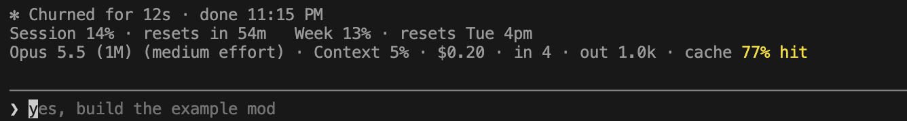

# usage-meter

A Claude Code mod that shows your plan usage and session spend in the band above the prompt.



Later in a busy window, with the pace projection showing:

```
Session 82% · resets in 2h 14m · ~48m to limit at this pace   Week 71% · resets Thu 9am
Opus 5.5 (1M) (high effort) · Context 34% · $1.37 · in 12.4k · out 8.1k · cache 94% hit
```

## What it shows

**Limits line** (Claude subscriptions only)
- **Session**: percent of the 5-hour window used and time until it resets.
- **Pace**: when your recent rate of use would hit the session limit *before* it resets, how long you have left. Projected from the last 45 minutes of readings; hidden when there's too little data or you're on track.
- **Week**: percent of the weekly limit used and the reset day and time, in local time.

**Session line**
- Model and the effort level sent with the last main-loop request
- Context window fill
- Session cost (the same total as `/cost`)
- Tokens this session: uncached input, output, and the share of input served from the prompt cache

Each line is hidden when it has no data; with no data at all the band is empty.

## Colours

| Figure | Amber | Red |
| --- | --- | --- |
| Session, week, context % | from 70% | from 90% |
| Cache hit rate | below 80% | below 50% |
| Pace | under the reset | under 30 minutes |

## Warnings

A toast appears when the session or weekly limit reaches 80% and again at 95%, once per window. It reacts as soon as a limit moves a whole point, so it can appear mid-turn.

## Install

```
/plugin marketplace add shubhamshinde245/claude-mods
/plugin install usage-meter@shubham-mods
```

Requires a Claude Code version with function-hook plugins (built and tested on 2.1.286).

## Notes

- Token totals count from when the mod loads; turns before that aren't included. They survive a mod reload but start over when Claude Code restarts.
- The effort level appears after the first request of the session.

## Privacy

usage-meter only reads figures Claude Code already has for the current session: rate-limit percentages and reset times, cost, token counts, context fill, model and effort level. It makes no network requests, runs no commands, reads no files and sends nothing anywhere. Everything it keeps is held in the session's own plugin state and is gone when Claude Code restarts.

## License

MIT
